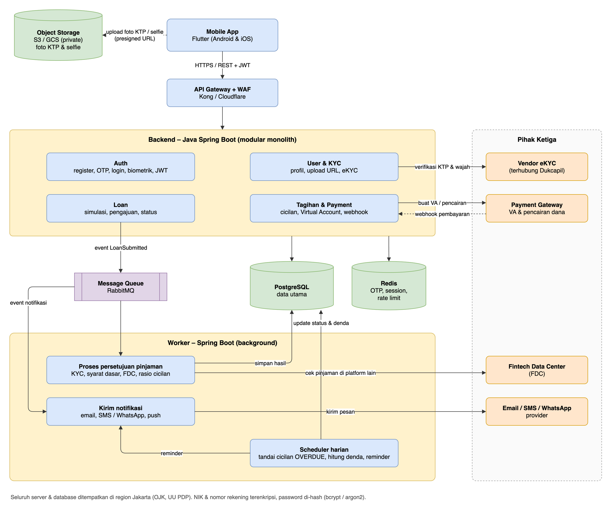

# 1. High Level Design Architecture

Saya memilih backend dalam bentuk **satu aplikasi yang dibagi per modul** (Auth, User & KYC, Loan, Tagihan & Payment), belum microservices. Untuk produk baru dengan tim yang belum besar, cara ini lebih cepat dibangun dan lebih mudah di-maintain. Kalau nanti salah satu modul butuh di-scale terpisah, modul itu bisa dipecah karena batasnya sudah jelas dari awal.

## Komponen

| Komponen          | Teknologi                                       | Fungsi                                                                                  |
| ----------------- | ----------------------------------------------- | --------------------------------------------------------------------------------------- |
| Mobile App        | Flutter                                         | Satu codebase untuk Android dan iOS                                                     |
| API Gateway + WAF | Kong / Cloudflare                               | Autentikasi token, rate limit, blokir traffic mencurigakan                              |
| Backend           | Java Spring Boot                                | Seluruh logika bisnis                                                                   |
| Database          | PostgreSQL                                      | Data user, pinjaman, cicilan, pembayaran                                                |
| Cache             | Redis                                           | OTP, session, rate limit                                                                |
| Object Storage    | S3 / GCS (private)                              | Foto KTP dan selfie                                                                     |
| Message Queue     | RabbitMQ                                        | Antrian proses persetujuan pinjaman dan notifikasi                                      |
| Worker            | Spring Boot (service terpisah)                  | Proses background: persetujuan pinjaman, kirim notifikasi, scheduler harian jatuh tempo |
| Pihak ketiga      | Vendor eKYC, FDC, payment gateway, email/SMS/WA | Verifikasi identitas, cek pinjaman di platform lain, VA dan pencairan, notifikasi       |

## Keputusan

- **Persetujuan pinjaman berjalan asinkron di worker lewat queue.** Pengecekan ke FDC dan vendor lain bisa makan waktu beberapa detik sampai menit, jadi app tidak perlu menunggu. User langsung melihat status "sedang diproses" dan mendapat notifikasi saat hasilnya keluar.
- **Scheduler harian di worker untuk cicilan jatuh tempo.** Setiap hari scheduler menandai cicilan yang lewat jatuh tempo dan belum lunas sebagai `OVERDUE`, menghitung denda, dan mengirim reminder sebelum serta sesudah jatuh tempo lewat modul notifikasi.
- **Foto KTP dan selfie di-upload langsung dari app ke object storage** memakai presigned URL, tidak lewat backend. File foto cukup besar dan akan membebani API kalau lewat backend.
- **Server dan database di region Jakarta.** Data pribadi dan data keuangan sebaiknya tetap di Indonesia untuk kebutuhan regulasi (OJK, UU PDP).
- **Proteksi data:** NIK dan nomor rekening disimpan terenkripsi. Password di-hash dengan bcrypt/argon2.
- **Keamanan di sisi app:** SSL pinning, deteksi root/jailbreak, dan token disimpan di Keystore (Android) / Keychain (iOS).
