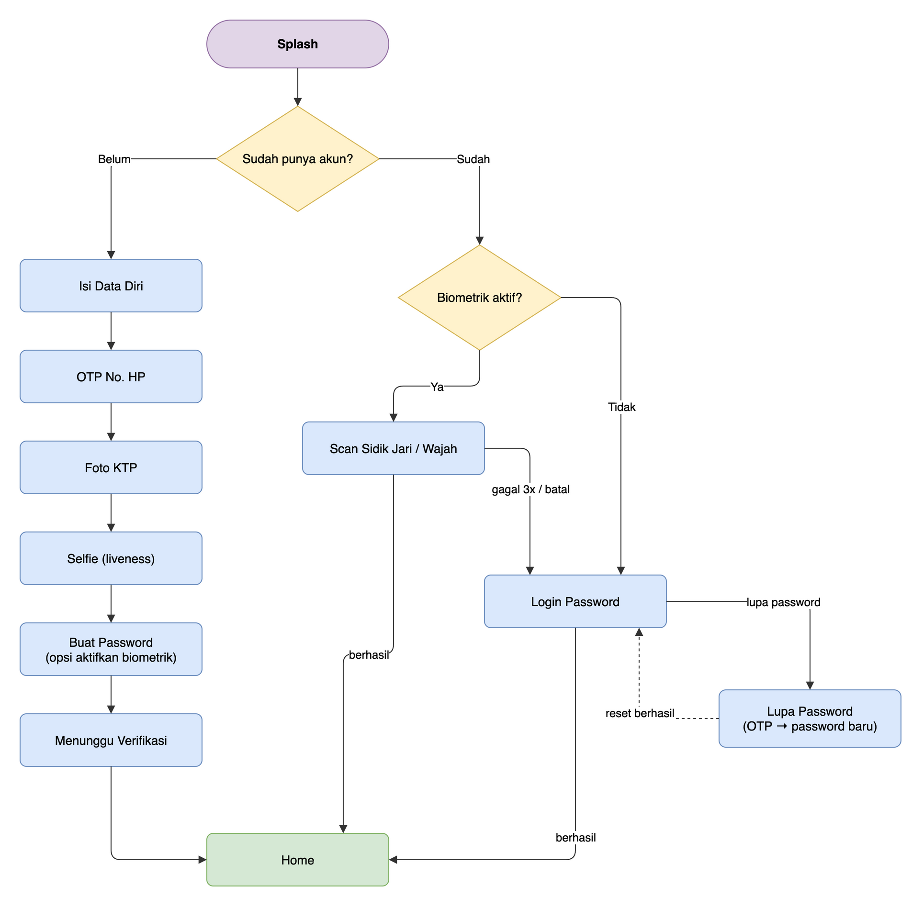
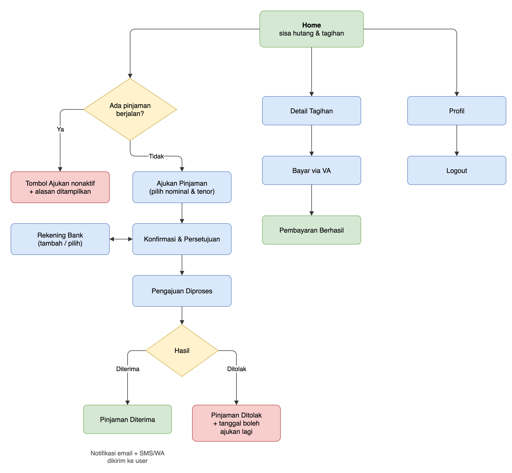
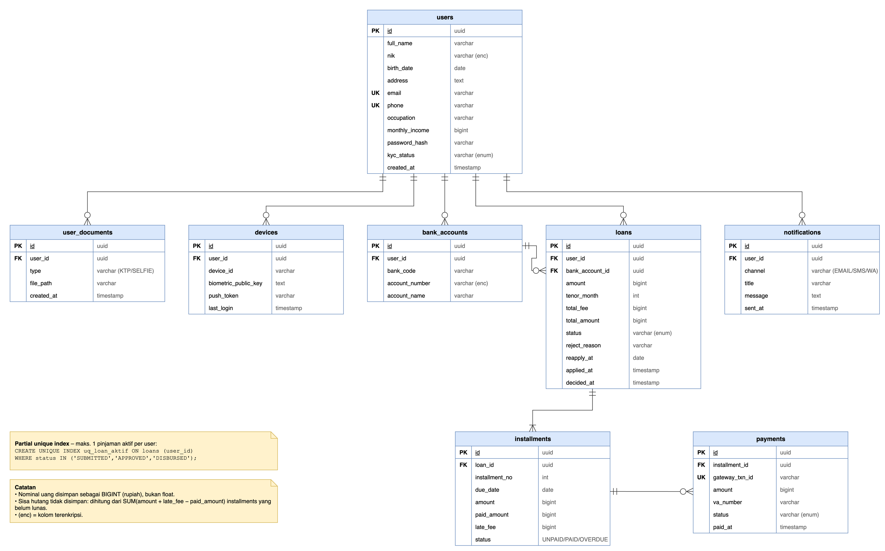

# 2. Screen Flow dan ERD

## Screen Flow

## Alur registrasi dan login

## Alur pinjaman, pembayaran, dan profil

## Daftar layar

| No | Layar                | Keterangan                                                            |
| -- | -------------------- | --------------------------------------------------------------------- |
| 1  | Splash               | Cek versi app dan status login                                        |
| 2  | Registrasi Data Diri | Input nama, NIK, tanggal lahir, email, no. HP, pekerjaan, penghasilan |
| 3  | Verifikasi OTP       | Verifikasi nomor HP                                                   |
| 4  | Foto KTP & Selfie    | Ambil foto KTP dan selfie untuk eKYC                                  |
| 5  | Buat Password        | Buat password, pilihan aktifkan biometrik                             |
| 6  | Login                | Login dengan biometrik atau password                                  |
| 7  | Home                 | Sisa hutang, tagihan bulan ini, tombol ajukan pinjaman                |
| 8  | Ajukan Pinjaman      | Pilih nominal dan tenor, lihat simulasi cicilan                       |
| 9  | Konfirmasi Pinjaman  | Rincian biaya, rekening pencairan, persetujuan                        |
| 10 | Status Pengajuan     | Status diproses / diterima / ditolak                                  |
| 11 | Detail Tagihan       | Jadwal cicilan dan status per bulan                                   |
| 12 | Pembayaran           | Nomor Virtual Account dan cara bayar                                  |
| 13 | Profil               | Data diri, pengaturan biometrik, logout                               |
| 14 | Lupa Password        | Verifikasi OTP ke no. HP, lalu buat password baru                     |
| 15 | Rekening Bank        | Tambah atau pilih rekening tujuan pencairan                           |

## ERD

| Tabel              | Keterangan                                                                                                                                                           |
| ------------------ | -------------------------------------------------------------------------------------------------------------------------------------------------------------------- |
| `users`          | Data diri user (termasuk alamat) dan status KYC (`PENDING`, `VERIFIED`, `REJECTED`)                                                                            |
| `user_documents` | Lokasi file foto KTP dan selfie di object storage                                                                                                                    |
| `devices`        | Device yang dipakai login, termasuk public key untuk biometrik dan push token (FCM/APNs) untuk push notification                                                     |
| `bank_accounts`  | Rekening tujuan pencairan dana                                                                                                                                       |
| `loans`          | Data pinjaman: nominal, tenor, biaya, status. `reapply_at` diisi saat pinjaman ditolak, berisi tanggal user boleh mengajukan lagi                                  |
| `installments`   | Jadwal cicilan per bulan, dibuat saat pinjaman disetujui. Menyimpan status (`UNPAID`, `PAID`, `OVERDUE`) dan denda keterlambatan (`late_fee`)                |
| `payments`       | Data pembayaran via Virtual Account, terhubung ke cicilan (`installment_id`) yang dibayar. `gateway_txn_id` (UNIQUE) menyimpan ID transaksi dari payment gateway |
| `notifications`  | Log notifikasi yang dikirim ke user                                                                                                                                  |
