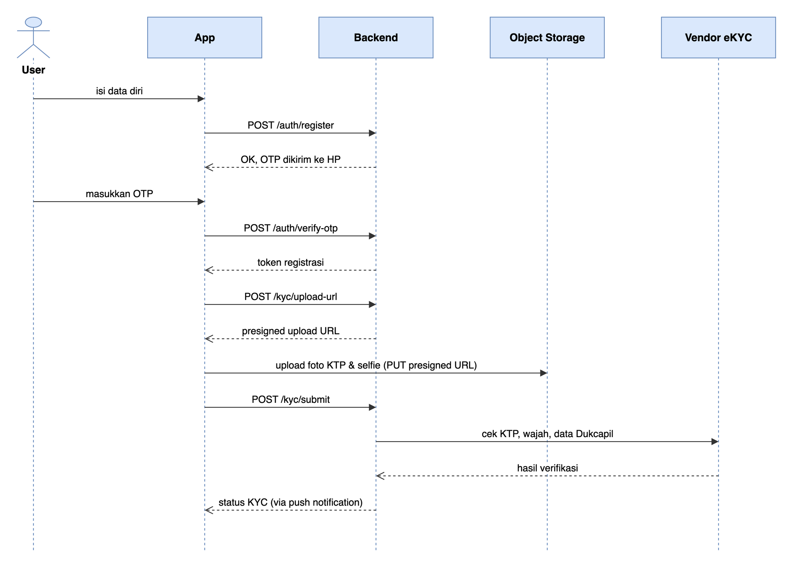
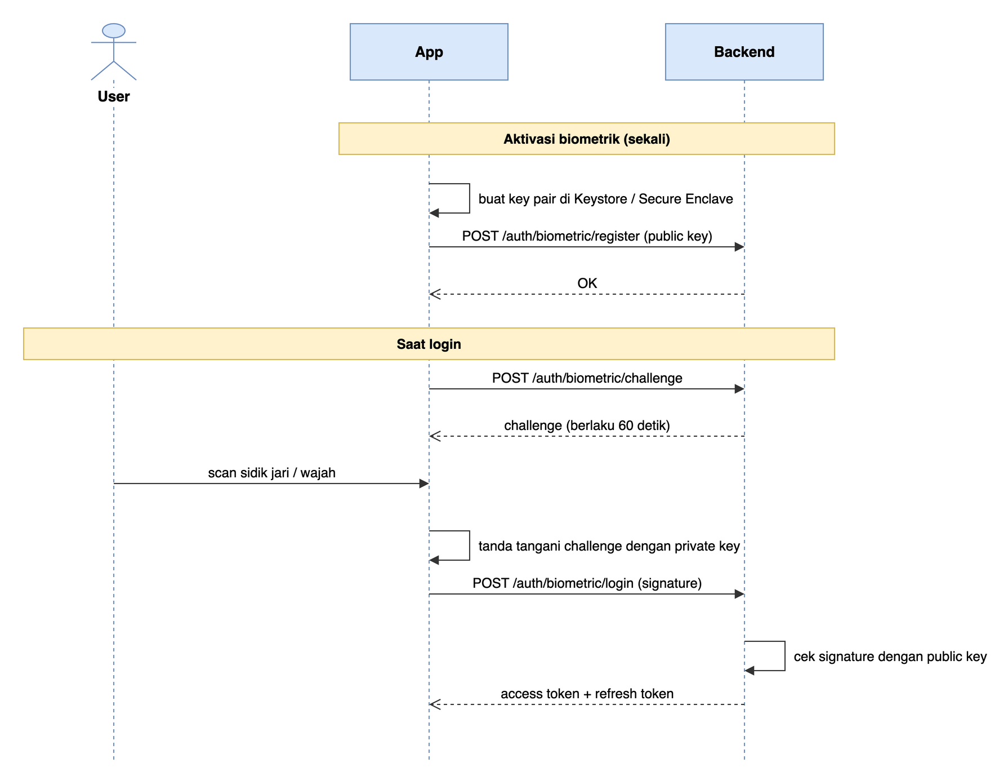
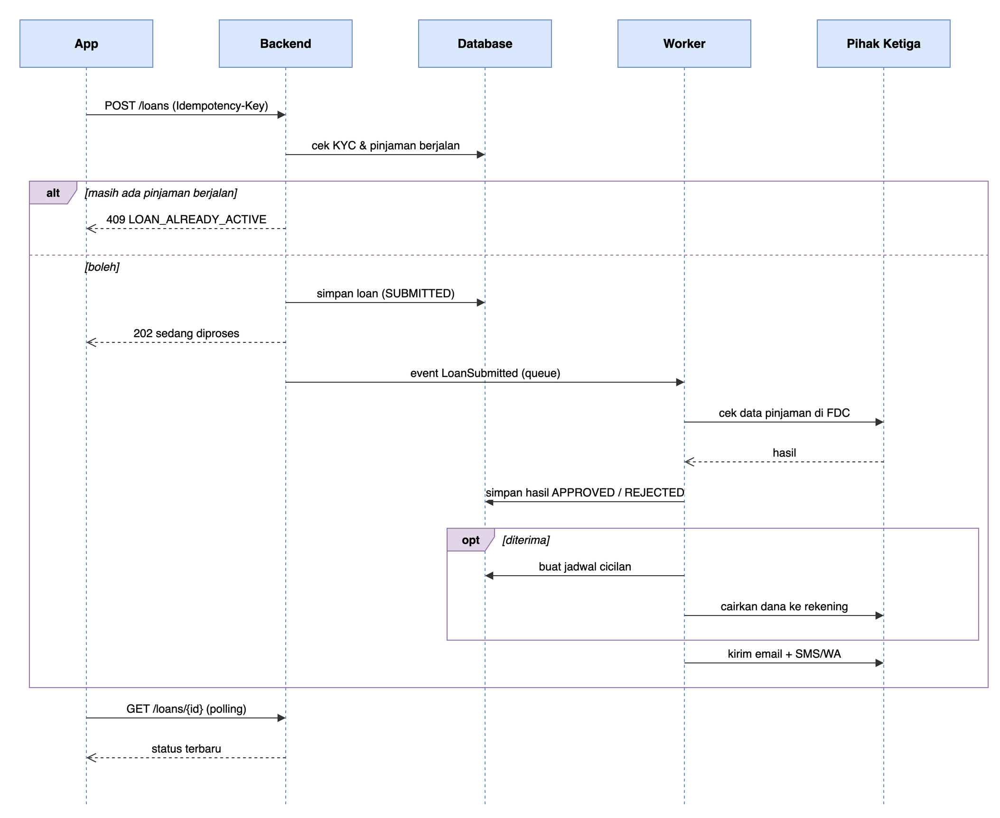
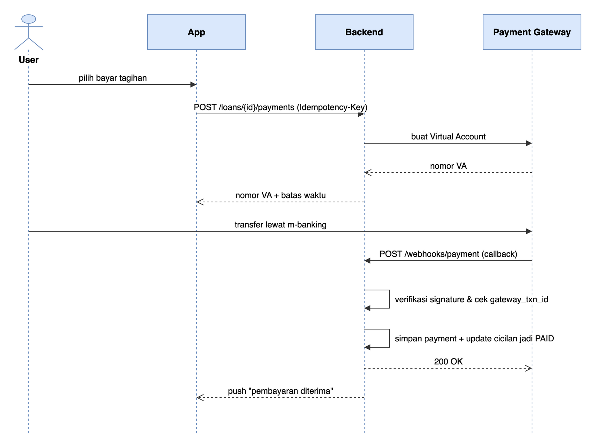
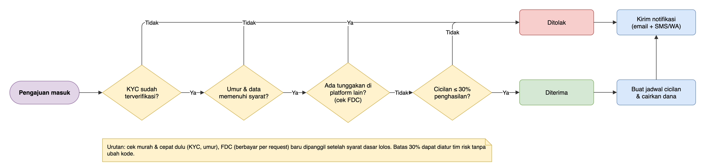
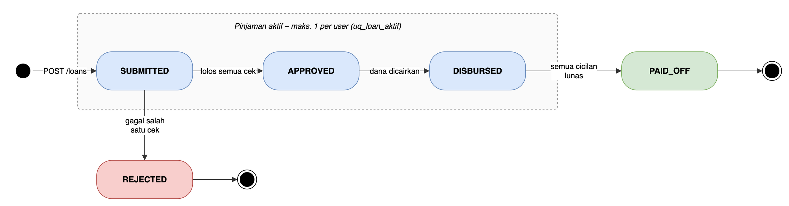

# 3. Detail Design API

- REST dengan format JSON, base URL `/api/v1`.
- Autentikasi memakai JWT. Access token berlaku 15 menit, refresh token 30 hari.

## Daftar Endpoint

| Method | Endpoint                      | Keterangan                                            |
| ------ | ----------------------------- | ----------------------------------------------------- |
| POST   | `/auth/register`            | Registrasi data diri, kirim OTP                       |
| POST   | `/auth/verify-otp`          | Verifikasi OTP                                        |
| POST   | `/kyc/upload-url`           | Minta URL untuk upload foto KTP dan selfie            |
| POST   | `/kyc/submit`               | Kirim data KTP dan selfie untuk diverifikasi          |
| POST   | `/auth/login`               | Login dengan email/no. HP dan password                |
| POST   | `/auth/biometric/register`  | Daftarkan public key biometrik dari device            |
| POST   | `/auth/biometric/challenge` | Minta challenge untuk login biometrik                 |
| POST   | `/auth/biometric/login`     | Login dengan signature biometrik                      |
| DELETE | `/auth/biometric`           | Nonaktifkan biometrik (hapus public key device ini)   |
| POST   | `/auth/forgot-password`     | Kirim OTP reset password ke no. HP terdaftar          |
| POST   | `/auth/reset-password`      | Verifikasi OTP lalu set password baru                 |
| POST   | `/auth/refresh`             | Perbarui access token                                 |
| POST   | `/auth/logout`              | Logout                                                |
| GET    | `/users/me`                 | Data profil user                                      |
| GET    | `/users/me/summary`         | Sisa hutang, tagihan bulan ini, status pinjaman       |
| PUT    | `/users/me/push-token`      | Simpan push token (FCM/APNs) device yang sedang login |
| GET    | `/users/me/bank-accounts`   | Daftar rekening pencairan                             |
| POST   | `/users/me/bank-accounts`   | Tambah rekening pencairan, nama pemilik dicek ke bank |
| POST   | `/loans/simulate`           | Hitung cicilan dari nominal dan tenor                 |
| POST   | `/loans`                    | Ajukan pinjaman                                       |
| GET    | `/loans/{id}`               | Detail dan status pinjaman                            |
| GET    | `/loans/{id}/installments`  | Jadwal cicilan                                        |
| POST   | `/loans/{id}/payments`      | Buat Virtual Account untuk bayar tagihan              |
| POST   | `/webhooks/payment`         | Callback dari payment gateway saat user membayar      |


## Contoh Request dan Response

### `POST /loans`

Request:

```json
{
  "amount": 6000000,
  "tenor_month": 6,
  "bank_account_id": "b7c1-..."
}
```

Response `202 Accepted`:

```json
{
  "loan_id": "a91f-...",
  "status": "SUBMITTED"
}
```

Response `409 Conflict`:

```json
{
  "code": "LOAN_ALREADY_ACTIVE",
  "message": "Anda masih memiliki pinjaman yang belum lunas"
}
```

### `GET /users/me/summary`

Response `200 OK`:

```json
{
  "outstanding": 4480000,
  "current_bill": {
    "installment_no": 3,
    "due_date": "2026-12-05",
    "amount": 1120000,
    "status": "UNPAID"
  },
  "can_apply_loan": false,
  "reason": "Anda masih memiliki pinjaman yang belum lunas"
}
```

Field `can_apply_loan` dan `reason` dipakai app untuk menentukan apakah tombol "Ajukan Pinjaman" aktif, sekaligus menampilkan alasannya kalau tidak aktif. `can_apply_loan` bernilai `false` kalau KYC belum `VERIFIED`, masih ada pinjaman aktif, atau `reapply_at` dari pinjaman yang ditolak belum lewat.

### `POST /users/me/bank-accounts`

Request:

```json
{
  "bank_code": "BMRI",
  "account_number": "1234567890"
}
```

Response `201 Created`:

```json
{
  "bank_account_id": "b7c1-...",
  "bank_code": "BMRI",
  "account_number_masked": "******7890",
  "account_name": "BUDI SANTOSO"
}
```

Response `422 Unprocessable Entity`:

```json
{
  "code": "ACCOUNT_NAME_MISMATCH",
  "message": "Nama pemilik rekening tidak sama dengan nama di KTP"
}
```

### `POST /loans/{id}/payments`

Request (header `Idempotency-Key` wajib):

```json
{
  "installment_id": "c3d4-..."
}
```

Response `201 Created`:

```json
{
  "payment_id": "f81a-...",
  "installment_id": "c3d4-...",
  "amount": 1120000,
  "va_number": "8808123456789012",
  "expired_at": "2026-12-05T23:59:59+07:00",
  "status": "PENDING"
}
```

## Sequence Diagram

### Registrasi dan Verifikasi KTP



Login Biometrik



### Pengajuan Pinjaman



Pembayaran Tagihan



Callback dari payment gateway bisa datang lebih dari sekali, jadi backend mengecek dulu apakah transaksi tersebut sudah pernah diproses, berdasarkan `gateway_txn_id` yang diberi unique constraint di tabel `payments`. Kalau sudah ada, backend langsung membalas `200 OK` tanpa memproses ulang. Backend juga memverifikasi signature callback agar request palsu tidak bisa menandai tagihan sebagai lunas.

## Flowchart Proses Persetujuan Pinjaman



Pengecekan yang murah dan cepat (status KYC, umur) dijalankan lebih dulu. Pengecekan ke FDC berbayar per request, jadi baru dipanggil setelah syarat dasar lolos. Batas 30% penghasilan bisa diatur oleh tim risk tanpa perlu ubah kode. Kalau hasilnya ditolak, worker juga mengisi `loans.reapply_at` dengan tanggal user boleh mengajukan lagi.

## State Diagram Status Pinjaman



Status `SUBMITTED`, `APPROVED`, dan `DISBURSED` dihitung sebagai pinjaman aktif. Selama user masih punya pinjaman di salah satu status ini, partial unique index `uq_loan_aktif` menolak pengajuan baru (lihat [ERD](../02-screen-flow-erd/README.md#aturan-satu-pinjaman-aktif-per-user)).
